# Casos de uso

> **Definición:** Documento que describe los actores, el catálogo de casos de uso y su especificación detallada.

## 1. Actores

| Actor | Tipo | Descripción |
| ----- | ---- | ----------- |
|       |      |             |

## 2. Catálogo

| ID  | Caso de uso | Actor | Requisitos |
| --- | ----------- | ----- | ---------- |
|     |             |       |            |

## 3. Especificación

### 3.1 UC-001

### 3.2 UC-002

## 4. Diagrama de casos de uso

```plantuml
@startuml
title Casos de uso
' Pendiente: actores, casos de uso y relaciones por definir.
@enduml
```

## 5. Referencias
