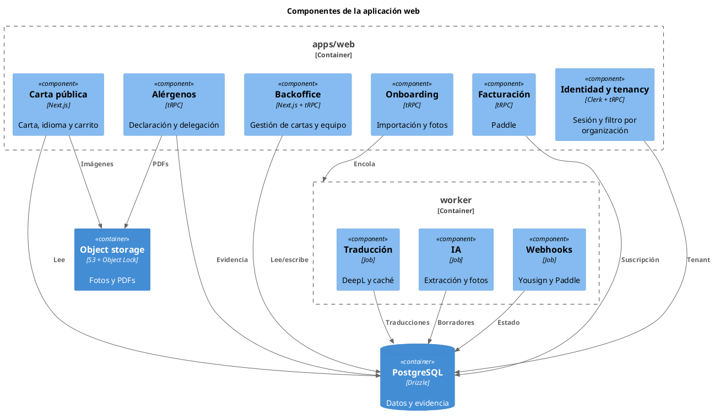

# Componentes (C4 nivel 3)

> **Definición:** Vista C4 de nivel 3 que descompone la aplicación en componentes con responsabilidad y dependencias.

## 1. Componentes por contenedor

| Contenedor | Componente | Responsabilidad | Dependencias |
| --- | --- | --- | --- |
| WEB | Carta pública | Renderizar `Catalog`, idioma y `Cart` | DB, Storage |
| WEB | Backoffice | CRUD de organización, cartas, productos y menús | DB, Clerk |
| WEB | Alérgenos | Declaración, delegación y firma | DB, Storage, Yousign |
| WEB | Onboarding | Importación IA y aprobación de fotos | DB, Storage, Worker |
| WEB | Facturación | Suscripción y portal de Paddle | DB, Paddle |
| WEB | Identidad y tenancy | Sesión, roles y filtro por organización | Clerk, DB |
| WORKER | Traducción | Traducir y cachear por hash | DB, DeepL |
| WORKER | IA | Extraer borradores y mejorar fotos | DB, Storage, IA |
| WORKER | Webhooks | Procesar firma y pago con idempotencia | DB, Yousign, Paddle |

## 2. Diagrama de componentes

## 3. Límites y responsabilidades

- La carta pública solo lee datos publicados; nunca ejecuta escrituras.
- El backoffice no accede a datos de otra `Organization`; el filtro vive en el repositorio.
- Los componentes de alérgenos no publican sin firma; el estado lo impone el dominio.
- Los jobs son idempotentes por `jobId` y hash de entrada.

## 4. Referencias

| ID | Documento |
| --- | --- |
| DOC-ARQ-003 | [Contenedores](contenedores.md) |
| ADR-0010 | [App única y tRPC](adr/ADR-0010-app-unica-y-trcp.md) |
