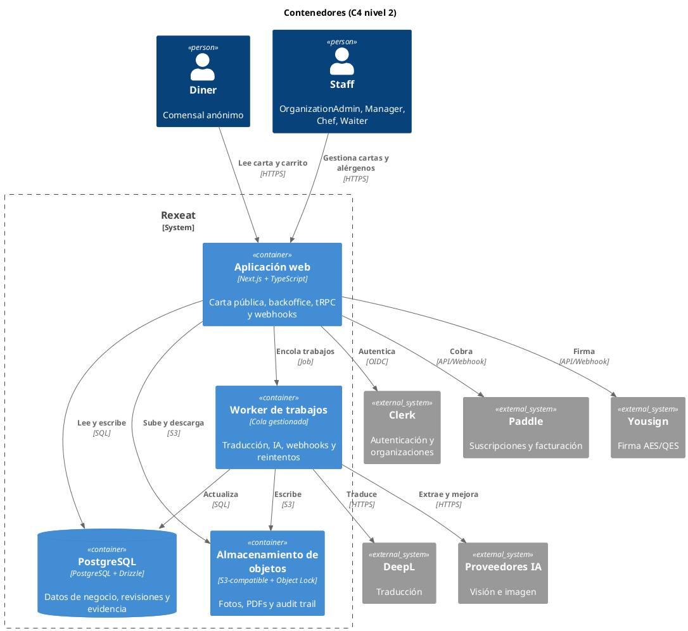

# Contenedores (C4 nivel 2)

> **Definición:** Vista C4 de nivel 2 que descompone el sistema en contenedores desplegables con su responsabilidad, tecnología y comunicación.

## 1. Contenedores

| ID | Contenedor | Responsabilidad | Tecnología | Despliegue |
| --- | --- | --- | --- | --- |
| WEB | Aplicación web | Carta pública, backoffice, tRPC y webhooks | Next.js + TypeScript | Vercel |
| WORKER | Trabajos | Traducción, IA, webhooks y reintentos | Cola gestionada | Proveedor gestionado |
| DB | Base de datos | Datos de negocio, revisiones y evidencia | PostgreSQL + Drizzle | Proveedor gestionado UE |
| STORAGE | Objetos | Fotos, PDFs y audit trail inmutable | S3-compatible + Object Lock | Proveedor UE |

## 2. Diagrama de contenedores

## 3. Comunicación

| Origen | Destino | Protocolo | Datos | Sincronía |
| --- | --- | --- | --- | --- |
| WEB | DB | SQL | Negocio y evidencia | Sí |
| WEB | STORAGE | S3 | Fotos y PDFs | Sí |
| WEB | WORKER | Cola | Jobs de traducción/IA | No |
| WEB | Clerk | OIDC | Sesión y organización | Sí |
| WEB | Paddle | API/Webhook | Suscripción | Mixta |
| WEB | Yousign | API/Webhook | Firma | Mixta |
| WORKER | DeepL | HTTPS | Textos | No |
| WORKER | IA | HTTPS | Cartas y fotos | No |

## 4. Referencias

| ID | Documento |
| --- | --- |
| ADR-0010 | [App única y tRPC](adr/ADR-0010-app-unica-y-trcp.md) |
