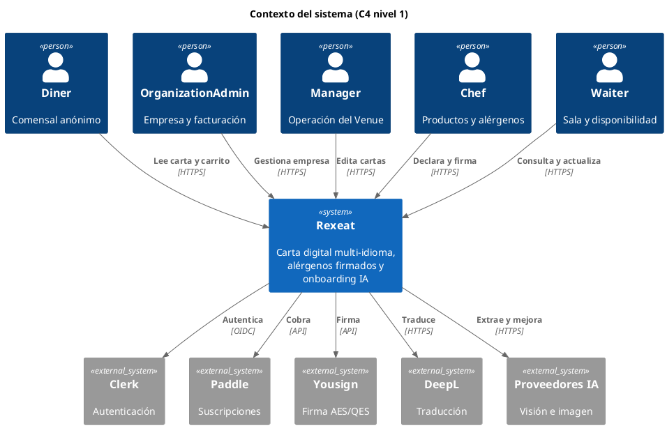

# Contexto del sistema (C4 nivel 1)

> **Definición:** Vista C4 de nivel 1 que delimita el sistema, sus actores y los sistemas externos con los que intercambia información.

## 1. Actores

| Actor | Tipo | Descripción |
| --- | --- | --- |
| `Diner` | Persona | Comensal anónimo que lee la carta y simula la comanda |
| `OrganizationAdmin` | Persona | Gestiona empresa, facturación y personal |
| `Manager` | Persona | Opera cartas y disponibilidad; firma con delegación |
| `Chef` | Persona | Declara y firma alérgenos; delega en `Manager` |
| `Waiter` | Persona | Consulta y actualiza disponibilidad |

## 2. Sistemas externos

| Sistema | Responsabilidad | Protocolo | Criticidad |
| --- | --- | --- | --- |
| Clerk | Autenticación y organizaciones | OIDC/API | Alta |
| Paddle | Suscripciones, IVA y facturación | API/Webhook | Alta |
| Yousign | Firma AES/QES y evidencia | API/Webhook | Alta |
| DeepL | Traducción automática | HTTPS | Media |
| Proveedores IA | Extracción de carta y mejora de fotos | HTTPS | Media |
| QR | Acceso del `Diner` a la carta | URL | Alta |

## 3. Diagrama de contexto

## 4. Flujos externos

| Origen | Destino | Datos | Frecuencia |
| --- | --- | --- | --- |
| `Diner` | Rexeat | Escaneo QR, idioma, selección | Por visita |
| `Organization` | Paddle | Suscripción y facturación | Mensual/anual |
| `Chef`/`Manager` | Yousign | Declaración canónica | Por publicación |
| Rexeat | DeepL | Textos de carta | Por cambio |
| Rexeat | IA | Fotos/PDFs | Onboarding y cambios |

## 5. Referencias

| ID | Documento |
| --- | --- |
| DOC-ARQ-003 | [Contenedores](contenedores.md) |
| ADR-0010 | [App única y tRPC](adr/ADR-0010-app-unica-y-trcp.md) |
