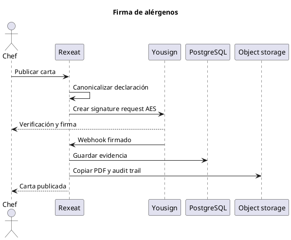

# Integraciones

> **Definición:** Catálogo de sistemas externos, patrones de integración y manejo de errores.

## 1. Catálogo

| ID | Sistema | Dirección | Protocolo | Formato | Criticidad |
| --- | --- | --- | --- | --- | --- |
| INT-01 | Clerk | Entrante/saliente | OIDC/API | JSON | Alta |
| INT-02 | Paddle | Saliente/entrante | API/Webhook | JSON | Alta |
| INT-03 | Yousign | Saliente/entrante | API/Webhook | JSON/PDF | Alta |
| INT-04 | DeepL | Saliente | HTTPS | JSON | Media |
| INT-05 | IA de visión | Saliente | HTTPS | JSON | Media |
| INT-06 | IA de imagen | Saliente | HTTPS | JSON/imagen | Media |

## 2. Patrones

- Webhooks idempotentes por ID del proveedor; se guarda el evento antes de procesar.
- Reintentos con backoff exponencial solo en 429 y 5xx; nunca en 4xx de validación.
- Timeout corto y cola para trabajos largos.
- Los fallos de traducción o IA degradan a contenido original; no bloquean la carta.

## 3. Diagrama de secuencia

## 4. Errores y reintentos

| Código | Causa | Reintento | Acción |
| --- | --- | --- | --- |
| 429 | Rate limit | Sí, backoff | Reencolar |
| 5xx | Fallo del proveedor | Sí, backoff | Reencolar y alertar |
| 4xx | Validación | No | Marcar error y avisar |
| Timeout | Proveedor lento | Sí, limitado | Fallback o reintento |

## 5. Seguridad

- Secretos en el proveedor de despliegue, nunca en el repositorio.
- Verificación de firma de webhooks.
- Datos enviados a proveedores: mínimo necesario; sin documento de identidad a Rexeat.
- Proveedores con residencia UE y DPA; SCC/TIA si aplica.

## 6. Referencias

| ID | Documento |
| --- | --- |
