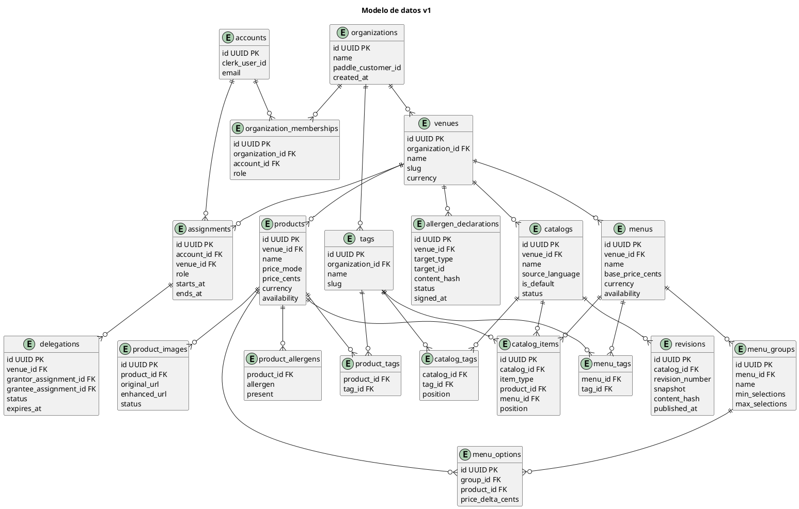

# Modelo de datos

> **Definición:** Esquema relacional de v1: tablas, relaciones, restricciones y reglas de integridad.

## 1. Principios

- PostgreSQL con Drizzle; migraciones forward-only.
- UUID v4 generado por PostgreSQL (`gen_random_uuid()`); `created_at` para ordenar.
- Dinero en enteros de céntimos + código ISO de moneda. EUR en v1.
- `organization_id` en toda tabla de tenant; `venue_id` donde aplique.
- Borrado lógico (`deleted_at`) en entidades de negocio; borrado real para datos personales tras la retención legal.
- Revisiones y evidencia inmutables: sin `UPDATE` ni `DELETE`.

## 2. Diagrama entidad-relación

## 3. Diccionario de datos

| Tabla | Propósito | Restricciones |
| --- | --- | --- |
| `organizations` | Empresa cliente y facturación | `id`, `created_at` |
| `accounts` | Login sincronizado con Clerk | `clerk_user_id` único |
| `organization_memberships` | `OrganizationAdmin` por empresa | Único activo por cuenta y empresa |
| `venues` | Locales de la empresa | `slug` único; `organization_id` |
| `assignments` | Puesto `(Account, Venue, Role)` | Un activo por cuenta, local y rol |
| `delegations` | Firma delegada de `Chef` a `Manager` | Mismo `venue`; vigencia ≤12 meses; doble firma |
| `tags` | Etiquetas intrínsecas | Únicas por empresa y slug |
| `catalogs` | Cartas del local | Un `is_default` por `venue` (índice parcial) |
| `catalog_tags` | Orden de secciones | PK `(catalog_id, tag_id)` |
| `products` | Items simples | `price_mode` fijo/mercado; precio coherente |
| `product_tags` | Etiquetas del producto | PK `(product_id, tag_id)` |
| `menus` | Items compuestos | Precio base ≥0 |
| `menu_tags` | Etiquetas del menú | PK `(menu_id, tag_id)` |
| `catalog_items` | Item dentro de una carta | Exactamente un `product_id` o `menu_id` |
| `menu_groups` | Grupos de opciones | `0 ≤ min ≤ max` |
| `menu_options` | Opción y complemento | `product_id` del mismo `venue` |
| `product_allergens` | 14 alérgenos UE | PK `(product_id, allergen)` |
| `product_images` | Original y mejorada | Original obligatorio; aprobación del `Chef` |
| `allergen_declarations` | Declaración firmada | `content_hash`; firma válida; cambio exige nueva |
| `revisions` | Snapshot inmutable por publicación | Sin `UPDATE`/`DELETE`; `content_hash` |
| `translations` | Campo traducido | Único por entidad, campo e idioma |
| `import_jobs` | Borrador IA | Estado y error; sin alérgenos |
| `subscriptions` | Suscripción Paddle | `paddle_subscription_id` único |
| `audit_events` | Auditoría append-only | Sin `UPDATE`/`DELETE` |

## 4. Índices y rendimiento

- Índices por `organization_id` y `venue_id` en todas las tablas de tenant.
- `venues.slug` y `catalogs` por `venue_id` para la carta pública.
- `revisions (catalog_id, revision_number)` y `content_hash`.
- `translations (entity_type, entity_id, field, locale)` único.
- `catalog_items (catalog_id, position)` para ordenar.

## 5. Migraciones

- Drizzle Kit; migraciones versionadas y revisadas.
- Nunca destructivas sin copia y ventana de mantenimiento.
- Las revisiones y evidencias no se migran con `UPDATE`; se preservan.

## 6. Retención

Ver la política interna de retención. Evidencia 6 años; cuenta 30 días tras cancelar; borradores 30 días; logs 90 días.

## 7. Referencias

| ID | Documento |
| --- | --- |
| DOC-ARQ-005 | [Modelo de dominio](modelo-dominio.md) |
| ADR-0010 | [App única y tRPC](adr/ADR-0010-app-unica-y-trcp.md) |
