# Modelo de dominio

> **Definición:** Documento que fija el lenguaje ubicuo, los agregados, las invariantes y los eventos de dominio del negocio.

## 1. Lenguaje ubicuo

| Término | Definición | Agregado |
| ------- | ---------- | -------- |
|         |            |          |

## 2. Entidades y agregados

| Agregado | Raíz | Entidades | Invariantes |
| -------- | ---- | --------- | ----------- |
|          |      |           |             |

## 3. Diagrama de clases

```plantuml
@startuml
title Modelo de dominio
' Pendiente: agregados, entidades, value objects y relaciones
@enduml
```

## 4. Invariantes

## 5. Eventos de dominio

| Evento | Emisor | Consumidor | Datos |
| ------ | ------ | ---------- | ----- |
|        |        |            |       |

## 6. Referencias

| ID  | Documento |
| --- | --------- |
|     |           |
