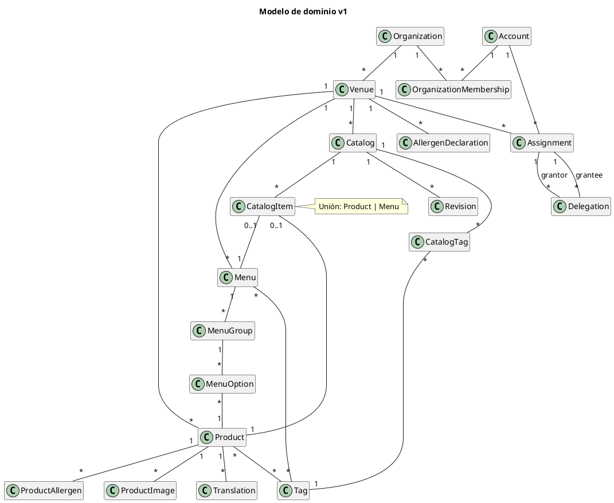

# Modelo de dominio

> **Definición:** Define las entidades, agregados, relaciones e invariantes del dominio de Rexeat y su lenguaje canónico.

## 1. Lenguaje ubicuo

Ver [glosario](../00-gobernanza/glosario.md). Términos canónicos en inglés; la documentación explica en español.

| Término | Papel |
| --- | --- |
| `Organization` | Empresa cliente y unidad de facturación |
| `Venue` | Local físico; unidad operativa |
| `Catalog` | Carta; agrupación de items; una por defecto |
| `Product` | Item simple con precio fijo o de mercado |
| `Menu` | Item compuesto con grupos de opciones y complementos |
| `Tag` | Etiqueta intrínseca al item; describe su naturaleza, no una sección |
| `Assignment` | Puesto `(Account, Venue, Role)` |
| `Delegation` | Autorización de firma entre `Chef` y `Manager` |
| `Diner` | Comensal anónimo |

## 2. Entidades y agregados

| Agregado | Raíz | Entidades | Invariantes |
| --- | --- | --- | --- |
| Organización | `Organization` | `OrganizationMembership`, `Venue` | Al menos un `OrganizationAdmin`; cada `Venue` pertenece a una sola `Organization` |
| Local | `Venue` | `Assignment` | Roles `Manager`, `Chef`, `Waiter` por puesto y vigencia |
| Carta | `Catalog` | `CatalogItem`, `CatalogTag` | Exactamente un `Catalog` por defecto por `Venue`; items del mismo `Venue`; orden de `Tag`s por carta |
| Producto | `Product` | `Tag`, `ProductAllergen`, `ProductImage`, `Translation` | Precio fijo o de mercado, nunca ambos; disponibilidad a nivel de `Venue`; etiquetas intrínsecas |
| Menú | `Menu` | `MenuGroup`, `MenuOption` | Precio base fijo; opciones con mínimo/máximo y complemento |
| Firma | `AllergenDeclaration` | firma, audit trail, `Delegation` | Solo `Chef` o `Manager` con delegación vigente; cambio de contenido exige nueva firma |

## 3. Diagrama de clases

## 4. Invariantes

- Un `Venue` tiene al menos un `Catalog` y exactamente uno marcado por defecto.
- Las etiquetas (`Tag`) son intrínsecas al item: un `Product` conserva las suyas en todas las `Catalog`s del `Venue`.
- Un `Catalog` no posee categorías propias; define el orden de sus `Tag` y cada item aparece bajo cada etiqueta que tenga.
- Una `Catalog` no se publica sin validación humana y firma de alérgenos vigente.
- Cada publicación crea una `Revision` inmutable con el snapshot de la carta; no se edita ni se borra.
- Un `Product` pertenece a un solo `Venue` y puede aparecer en varias `Catalog`s de ese `Venue`.
- La disponibilidad es del `Product` en el `Venue`; se comparte entre cartas.
- Un `Menu` es un item de `Catalog` que agrupa `Product`s del mismo `Venue`.
- `Menu.basePrice` es el mínimo; los complementos se suman por opción. El precio final se calcula con las selecciones; el precio de mercado solo existe en `Product`.
- Cada `MenuGroup` declara mínimo y máximo de selecciones; es obligatorio si el mínimo es mayor que cero.
- El carrito es efímero: no crea pedido ni se envía a cocina; solo muestra el resumen al `Diner`.
- Una opción de `Menu` referencia un `Product`; no se copia.
- La traducción nunca sobrescribe el original; cada campo guarda original, idioma, origen y estado.
- Una `AllergenDeclaration` cubre una versión completa; cualquier cambio invalida la firma anterior.
- Una `Delegation` une un `Assignment` de `Chef` y uno de `Manager` del mismo `Venue`, con doble firma y vigencia máxima de 12 meses.

## 5. Eventos de dominio

| Evento | Emisor | Consumidor |
| --- | --- | --- |
| `CatalogPublished` | `Catalog` | Carta pública, caché, traducción |
| `ProductAvailabilityChanged` | `Product` | Carta pública, menús que lo referencian |
| `DelegationGranted` | `Delegation` | Firma de alérgenos |
| `AllergenDeclarationSigned` | `AllergenDeclaration` | Publicación y auditoría |
| `MenuImported` | Importación IA | Borrador de `Catalog` |

## 6. Referencias

| ID | Documento |
| --- | --- |
| DOC-GOB-002 | [Glosario](../00-gobernanza/glosario.md) |
| ADR-0005 | [Asignaciones y delegación](adr/ADR-0005-asignaciones-y-delegacion.md) |
